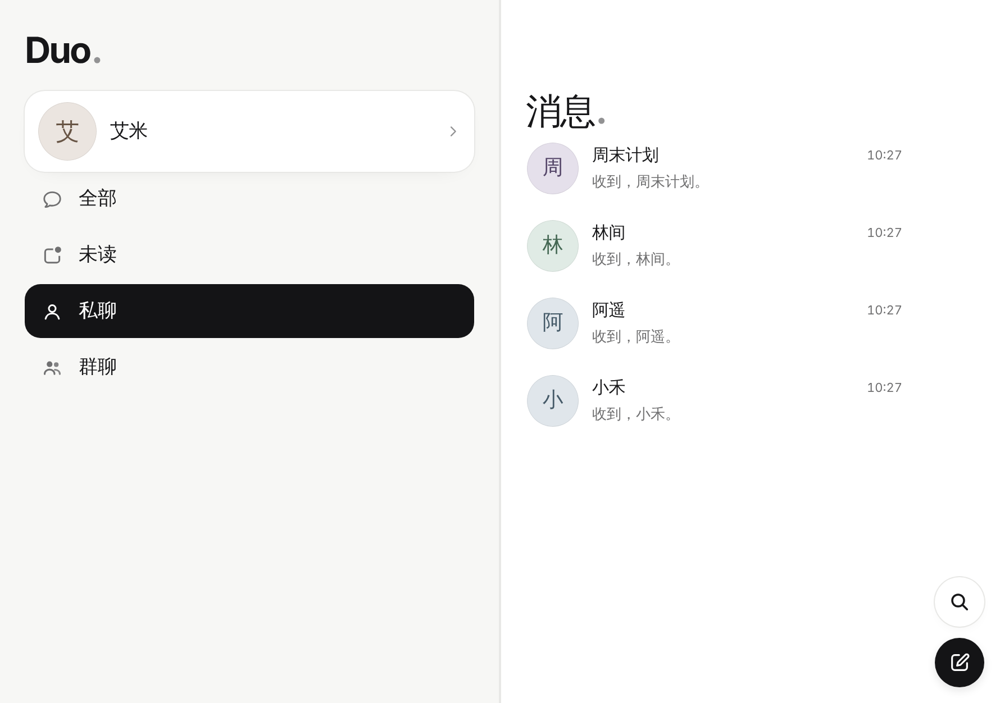
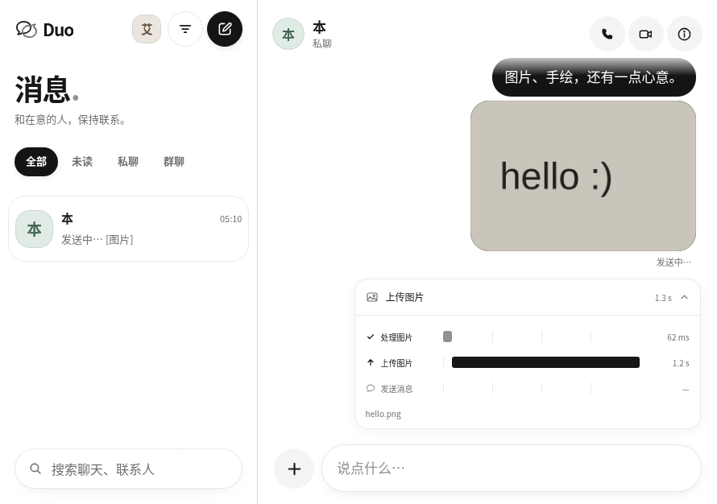

# Duo · Cloudflare 自建即时通讯

一个完全跑在 **Cloudflare** 上的自建即时通讯 App：注册账号、加好友、单聊和群聊、
发图片和手绘、语音 / 视频通话。没有第三方服务，消息和媒体都存在你自己的
Cloudflare 账号里。界面参考 iOS“信息”，并借鉴 Benji Taylor（Family / Honk /
drawesome）的设计与动效，专门为 **iPhone Duo** 的外屏（折叠）与内屏（展开）打磨。

界面沿用 Cuven Transfer / Worker Studio 的纸白与近黑设计语言：共享选中胶囊、
触下反馈与弹簧回弹、浮动输入框、可跟手关闭的纸感弹层。登录、消息、手绘和设置
使用同一套间距与材料层级，支持深色、减少动态效果及窄窗口。

融入 Magnetic Dropzone、Input OTP、Halftone Dots、Dropdown Menu 和 Trace Waterfall
的交互细节：图片可拖入或粘贴，预览后确认发送；邀请码保留完整原生输入，辅以分段焦点轨道；
点阵插画可切换心情；菜单高亮跟随鼠标和键盘；发送记录展示实际处理、上传和发送阶段及耗时。

双屏界面按 Apple《[针对 iPhone Duo 设计](https://developer.apple.com/design/human-interface-guidelines/designing-for-iphone-duo)》重新设计：

- **一条横向的栏带**：边栏 | 列表 | 对话 | 详情 四栏排成一条，屏幕是在这条栏带上滑动的窗口——合上时看一栏，
  打开时看相邻两栏（等宽）。前进时窗口向右滑一栏，“返回”、从左缘轻扫或浏览器后退时向左滑；轻扫 1:1 跟手，
  松手时按速度决定完成还是弹回。折叠 / 展开时，正在使用的那一栏留在屏幕上：例如打开时看着对话与详情，
  合上后看到的是详情；打开时在对话里输入，合上后仍是对话。
  - **边栏**：头像与名字（打开设置）、全部 / 未读 / 私聊 / 群聊（只有未读带数字），独占屏幕时还有搜索与新聊天。
  - **详情**：对话的“聊天信息”（免打扰、置顶、成员、退出 / 删除）和画板都在对话旁边这一栏打开，
    边看对话边画；合上时“关闭”变为“返回”。
  - 前置栏的控制横排、后置栏跟随窗口；与边栏并排时列表不再重复筛选与品牌，对话在视野外时新消息重新计为未读。
- **少用说明文字**：让布局自己说明——去掉副标题、分组说明、重复的占位提示和功能介绍；详情栏不加标题（顶部的头像与名字已经说明是谁），
  私聊标题下只在对方在线时显示状态。
- **垂直控制**：外屏与横向展开的内屏上，工具栏与导航控制移到后缘（右侧）的一列：顶部留给外屏相机与状态栏，
  其下依次是“返回”、通话、聊天信息，底部是画板、照片；与列表并排时这一列末端还有“新聊天”（与“邮件”“备忘录”一致）。
  只有纵向空间充足的窗口（内屏竖放、普通 iPhone）保留标准的顶栏与底栏。外屏横放时相机在这一列底部，“返回”移到最上方。
  外屏与内屏上系统都在右缘留出自己的一列（状态栏、灵动岛，真机上右侧安全区约 84pt），这一列控制直接放进系统列、对齐在状态栏下方，
  内容延伸到安全区边缘；没有这样一列的屏幕上（以及分栏的前置栏），控制列仍在安全区内。真机内屏为 951×669pt。
- **溢出**：空间不足时，项目按优先级从下往上收进唯一的“更多”（省略号只用于溢出），“返回”与带角标的项目保留得最久；
  焦点跟随项目进出溢出菜单。每个项目都有符号与标题，标题用于溢出菜单、辅助功能与提示。
- **分栏浏览**：前置栏（如列表）的控制横排在其上方、搜索在底部；部分折叠时两栏以折叠区为界，
  内容与弹层都不跨越折叠区（通过浏览器的视口分段检测）。像笔记本一样折起时，消息在折痕上方，输入在下方。
- **弹层**：外屏上表单、照片查看器、画板与通话的“关闭”都位于后缘一列的顶部；内屏上放在前置栏一侧的表单保持横向栏，
  放在后置栏一侧的则使用垂直栏。通话时标题与自拍预览移到前缘，避开相机。
- 双方头像标记消息分组，连续照片合为照片叠；消息可以回应（长按菜单或双击 ❤️），私聊“已读”重开后仍保留。
  折叠与展开之间以视图过渡衔接，布局变化保留草稿、选区与阅读位置；减少动态效果时直接切换。


| 合上：对话 | 打开：列表 + 对话 | 滑一栏：对话 + 详情 | 合上：详情 |
| --- | --- | --- | --- |
|  |  |  |  |

| 打开：边栏 + 列表 |
| --- |
|  |

| 折叠（外屏 466×678） | 展开（内屏 890×626） |
| --- | --- |
|  |  |
|  |  |
|  |  |
|  |  |

| 非零侧边 / 底部安全区 | 键盘弹出：从下往上收进“更多” | 外屏横放：相机在列底 |
| --- | --- | --- |
|  |  |  |

| 部分折叠（书本）：两栏以折叠区为界 | 部分折叠（笔记本）：消息在上，输入在下 |
| --- | --- |
|  |  |

| 图片发送前预览 | 真实阶段与耗时 |
| --- | --- |
|  |  |

> 截图来自本地 `wrangler dev`，账号和消息都是演示数据。

## 功能

- **账号**：用户名 + 密码注册 / 登录（PBKDF2 哈希），可选邀请码 `SIGNUP_CODE`
- **实时聊天**：单聊、群聊；消息经 WebSocket 实时送达，掉线自动重连补收
- **在线状态**与**已读回执**（私聊重新打开后仍显示“已读”）；**“正在输入”实时预览**（Honk 式：对方能看到你正在打的字）
- **回应**：长按消息从 ❤️ 😂 👍 😮 😢 🙏 中选一个，或双击送出 ❤️；每人每条消息一个，实时同步
- **图片**（手机端先压缩再传）与**手绘画板**（速度自适应笔触、调色板、撤销，发出为“手绘”消息）
- **语音 / 视频通话**：基于 **Cloudflare Realtime（SFU）**，一对一与群组都支持，可配置 TURN 中继
- **联系人**：按用户名查找、互相添加；发起单聊 / 新建群聊、群成员管理
- **通知**：新消息 Web Push（需加到主屏幕并配置 VAPID）
- **外观**：默认白色浅色界面，可切换深色 / 跟随系统；降低透明度、减少动态效果、触感反馈
- **iPhone Duo**：按 Apple HIG 设计——后缘垂直控制与优先级溢出、外屏单栏 / 内屏分栏、折叠区与相机避让、弹层按位置选择栏的方向

## 架构

```
iPhone (PWA)  ──HTTPS / WebSocket──▶  Worker（瘦代理）  ──▶  Hub Durable Object "main"
  静态页面 public/                     /api /auth /rtc        · 账号 / 联系人 / 房间 / 消息（SQLite）
  Service Worker：离线壳 + 推送          转发到 Hub            · 可休眠 WebSocket 实时收发 + 在线状态
                                                             · 媒体校验后读写 R2
                        WebRTC 媒体 ◀──▶ Cloudflare Realtime  · 通话信令中转 + /rtc 代理（App Secret 只在服务端）
                        离线成员 ◀────── Web Push（VAPID）
```

- **Worker（`src/index.js`）**：只做转发与同源校验，所有状态都在一个 Durable Object 里。
- **Hub（`src/hub.js`）**：账号、联系人、房间、消息、在线状态、WebSocket 广播、通话信令，
  全部集中在一个 DO，SQLite 强一致，推理简单。
- **数据层（`src/store.js`）**：users / contacts / rooms / room_members / messages / push_subs。
- **媒体（`src/media.js`）**：上传按会话成员与大小校验后流式写入 **R2**；下载带 sandbox CSP + nosniff，
  按会话成员鉴权。
- **通话（`src/call.js`）**：信令走 WebSocket；媒体经 `/rtc/*` 代理到 **Cloudflare Realtime SFU**，
  App Secret 不下发浏览器；TURN 凭证由 Realtime TURN key 下发。
- **账号加密（`src/auth.js`）**：PBKDF2-HMAC-SHA256（100k 轮，Workers WebCrypto 的迭代上限）哈希密码；HMAC 签名会话令牌，
  携带 epoch，可“全端退出”。

## 部署

需要一个 Cloudflare 账号。Durable Objects 的 SQLite 存储需要 Workers 付费版（$5/月）。

```bash
npm install

# 1) 创建 R2 存储桶（媒体文件）
npx wrangler r2 bucket create cf-messenger-media

# 2) 可选：设置邀请码，避免任何人都能注册
npx wrangler secret put SIGNUP_CODE

# 3) 部署
npx wrangler deploy
```

打开部署后的地址，点“创建账号”注册第一个用户即可。把地址发给朋友，各自注册、互相添加。

### 从旧版升级 / 使用 Workers Builds

- 使用 Node.js 22 或更新版本（Wrangler 4.152.0 要求 Node.js ≥22，仓库的 `.node-version` 已指定 22）。
- 当前连接的 Cloudflare Worker 是 `wechatduo`，与 `wrangler.jsonc` 的 `name` 保持一致。
  如果部署到另一个 Worker，先修改 `name`；设置 secret 时也应使用同一个配置。
- `routes` 保留现有自定义域名 `wechat.cuven.us`，避免部署时清除仪表盘上的域名绑定。
  自建到其他账号时，应改成自己的域名，或移除这项配置。
- Workers Builds 的根目录使用仓库根目录，构建命令留空（静态文件无需编译），部署命令使用
  `npm run deploy`。首次部署前，在同一个 Cloudflare 账号创建 `cf-messenger-media` R2 桶。
- 拉取请求的构建运行 `npx wrangler preview`，使用 `wrangler.jsonc` 里的 `previews` 配置：每个预览有独立的 Hub
  （账号、消息互不影响生产），媒体写入单独的桶。在同一账号创建一次：
  `npx wrangler r2 bucket create cf-messenger-media-preview`。预览不继承生产 secret，需要时用
  `npx wrangler preview secret` 设置。
- 旧版已执行 `v1`（`WeChatSession`），升级由新增的 `v2` 创建 `Hub`。
  保留历史迁移和旧类导出，不要把 `v1` 改成 `Hub`，也不要删除旧 namespace。
  旧微信存储保留但不再使用；Duo 的账号和消息从独立的 Hub 数据库开始。

如果部署仍失败，打开 Cloudflare → Workers & Pages → `wechatduo` → Builds 中的失败构建，
查看最后的错误：缺少 `Hub` 类 / namespace 通常与迁移链有关；R2 bucket 不存在则需先创建上述桶。
`wrangler deploy --dry-run` 只验证本地打包，不验证线上迁移状态、账号权限或 R2 桶是否存在。

### 开启语音 / 视频通话（Cloudflare Realtime）

1. 在 Cloudflare 仪表盘进入 **Realtime → Serverless SFU**，创建应用并保存 App ID 和 App Secret。
   项目使用 SFU 应用的凭据；RealtimeKit 的应用 ID 和密钥属于另一套接口。
   [SFU 控制台](https://dash.cloudflare.com/?to=/:account/realtime/sfu) · [官方说明](https://developers.cloudflare.com/realtime/sfu/get-started/)
2. 打开 **Workers & Pages → wechatduo → 设置 → 变量与密钥**，将 `REALTIME_APP_ID` 和
   `REALTIME_APP_SECRET` 添加为 **Secret**，保存并部署。这些是 Worker 的运行时配置。
   也可以在仓库根目录用 Wrangler 设置：

   ```bash
   npx wrangler secret put REALTIME_APP_ID
   npx wrangler secret put REALTIME_APP_SECRET
   # 可选：在 Realtime → TURN 创建 TURN Key，改善受限网络下的连通性
   npx wrangler secret put REALTIME_TURN_KEY_ID
   npx wrangler secret put REALTIME_TURN_KEY_TOKEN
   ```

3. 刷新聊天页面，用两台设备、两个账号测试，双方保持页面打开。语音需允许麦克风，视频还需允许摄像头。

未配置时，通话入口会提示“通话服务未配置”，其余功能照常。变量存在只表示入口已启用，不代表上游认证成功。
SFU 凭据被拒绝时会提示核对同一个 Serverless SFU 应用的 App ID / App Secret；TURN 凭据错误会单独提示。
未配置可选 TURN 时使用公共 STUN，受限网络建议补齐 TURN。权限、设备占用、媒体协商和网络失败会分别显示提示。

### 开启新消息通知（可选）

```bash
npm run vapid                          # 生成一对 VAPID 密钥
npx wrangler secret put VAPID_PUBLIC_KEY
npx wrangler secret put VAPID_PRIVATE_KEY
npx wrangler secret put VAPID_SUBJECT   # 例如 mailto:you@example.com
```

iOS 需先用 Safari“添加到主屏幕”，再从主屏幕打开，在“设置 › 通知”里开启。

### 配置项

| 名称 | 类型 | 说明 |
| --- | --- | --- |
| `SIGNUP_CODE` | secret，可选 | 注册邀请码；不设置则任何人都能注册 |
| `REALTIME_APP_ID` / `REALTIME_APP_SECRET` | secret | 语音 / 视频通话（Cloudflare Realtime SFU） |
| `REALTIME_TURN_KEY_ID` / `REALTIME_TURN_KEY_TOKEN` | secret，可选 | Realtime TURN，改善 NAT 穿透 |
| `VAPID_PUBLIC_KEY` / `VAPID_PRIVATE_KEY` / `VAPID_SUBJECT` | secret，可选 | Web Push 通知 |
| `DO_LOCATION_HINT` | var，默认 `apac` | Durable Object 首次创建的大致位置 |

## 本地开发

```bash
npm run dev          # wrangler dev，打开 http://127.0.0.1:8787 ，点“创建账号”
npm test             # 数据层与账号加密单测 + Web Push（RFC 8291 测试向量）
```

- 本地 `wrangler dev` 自带内存版 Durable Object SQLite 和 R2，无需额外配置即可跑通聊天与媒体。
- 想本地试通话 UI：`npx wrangler dev --var REALTIME_APP_ID:dummy --var REALTIME_APP_SECRET:dummy`
  （信令与来电界面可用；真正接通需要真实的 Realtime 应用）。
- 界面走查脚本：`node tools/e2e/walkthrough.cjs docs/screenshots` 用 Playwright（Chromium）
  注册两个账号，跑一遍登录 → 找人 → 实时收发 → 手绘 → 通话界面 → 展开 / 深色，并截图。
- 交互回归：`node tools/e2e/design-details.cjs` 验证图片预览、拖放 / 粘贴、真实上传、失败重试、
  任意长度邀请码和 320px 窄屏；只连接本地服务，截图写入 `screenshots-design/`。
- 双屏回归：`node tools/e2e/duo-layout.cjs` 验证照片叠放与展开、双账号回应与已读、相册切换与焦点恢复、
  分栏比例与后缘控制顺序、模拟书本 / 笔记本折叠时的分栏与弹层位置、内屏竖放的标准栏、
  折叠前后的草稿 / 选区 / 阅读位置、小窗口发送和列顶“返回”；只连接本地服务。
- 安全区回归：`node tools/e2e/safe-layout.cjs` 按窗口尺寸检查控制所在的轴、安全区与 44pt 点按区域、
  相机 / 状态栏避让、内容不被控制列遮挡、从下往上的溢出与焦点、200% 字号；使用前端示例数据，不创建服务端账号。
- 栏带回归：`node tools/e2e/strip.cjs` 依次走一遍 合上看对话 → 打开（列表 + 对话）→ 滑到对话 + 详情 → 合上看详情 →
  轻扫回到对话，并检查浏览器前进 / 后退、边栏范围、视野外的未读、折叠时保留正在使用的那一栏、减少动态效果；
  再按 [iphone-duo-web](https://github.com/trustworkscompany-dev/iphone-duo-web-skill) 的设备矩阵
  （466×678、678×466、951×669、890×626、669×951、626×890、475×669、669×475）检查栏数、居中的折痕间隙、溢出与 44pt 控制，
  并把宽度在 466 ↔ 951 之间逐步拖动，确认折叠不会被误判为键盘、弹层不压在折痕上。
- 折叠模拟：在地址后加 `?fold=vertical`（书本）或 `?fold=horizontal`（笔记本），或在控制台调用
  `(await import('/js/ui/viewport.js')).emulateFold({ axis: 'vertical' })`。
- 通话回归：`node tools/e2e/calls.cjs` 使用本地浏览器模拟 SFU 与虚拟麦克风 / 摄像头，
  检查真实 WebRTC 协商、错误提示和通话切换时序；不调用生产 SFU，也不验证生产凭据。

## 安全

- 密码用 PBKDF2-HMAC-SHA256（100k 轮）加随机盐哈希；会话是 HMAC 签名令牌（HttpOnly、SameSite=Strict）。
- 改密码会提升 epoch，使旧令牌失效（相当于全端退出）。
- 改状态的请求与 WebSocket 升级都做同源校验。
- 媒体下载响应带 `sandbox` CSP 与 `nosniff`，并按会话成员鉴权；上传限制大小与成员。
- 通话的 Realtime App Secret 只在服务端，浏览器只通过 `/rtc/*` 代理访问。

## 已知限制

- 语音 / 视频通话需要配置 Cloudflare Realtime 应用；未配置时入口会提示。
- 暂不支持录制语音消息（可发文字、图片、手绘；可打语音 / 视频通话）。
- 单个 Durable Object 承载全部状态，适合个人与中小群体自建；超大规模需要分片。
- 非端到端加密：消息在服务端（你自己的 Cloudflare 账号）以明文存储。
- iPhone Duo 上的 Safari 没有折叠 API（不支持 CSS Viewport Segments 与 Device Posture）：折叠 / 展开只表现为宽度变化。
  栏带、等宽两栏与弹层分侧都只依赖宽度，在 Safari 上完整可用；书本 / 笔记本半折时让开折痕的细化只在提供视口分段的浏览器
  （Chromium）上生效，属于渐进增强。内屏的点网格是 951×669 还是 890×626 尚未确定，两者都已测试。
- 无法在真机上验证的部分：iOS 键盘动画、`<input switch>` 触感、Apple 推送送达、
  真实 Realtime SFU 接通质量（开发环境无法访问 Realtime 服务）、真机摄像头与安全区的实际数值。
- 折叠 / 展开过渡依赖浏览器的视图过渡（View Transitions，Safari 18 / Chromium 111 起）；不支持时直接切换。

## 目录

```
src/            index.js（瘦代理）· hub.js（Durable Object）· store.js（SQLite）
                auth.js（账号加密）· media.js（R2）· call.js（Realtime 信令/代理）· push/
public/         index.html · manifest · sw.js · css/ · icons/
  js/           main.js · api.js · store.js
    ui/         视口与折叠、栏带（strip）、工具栏、符号与符号动效、弹簧、按压、外观、格式、触感
    views/      auth · sidebar · chatList · thread · artifact（详情栏）· bubbles · composer
                overlay · sheets · shell · viewer · call（通话）· draw（画板）· avatar
tools/          gen-vapid.mjs · gen-springs.mjs · gen-symbols.py · e2e/（walkthrough · design-details · duo-layout · safe-layout · strip）
test/           store · auth · webpush
```

## 致谢

- 交互与视觉参考 iOS“信息”，并借鉴 **Benji Taylor** 的 Family（弹性物理与触感）、
  Honk（实时打字、无发送键）与 drawesome（手绘）。
- 语音 / 视频通话基于 [Cloudflare Realtime](https://developers.cloudflare.com/realtime/)（SFU）。
- Web Push 按 RFC 8291 / 8292 用 WebCrypto 实现。
