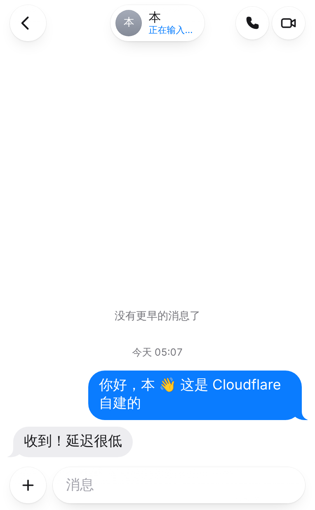
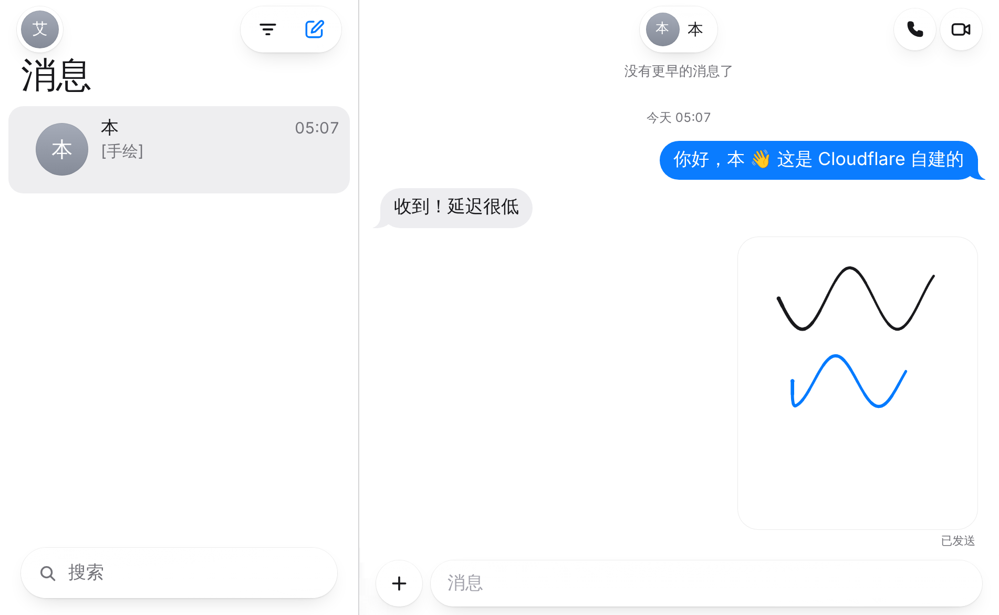
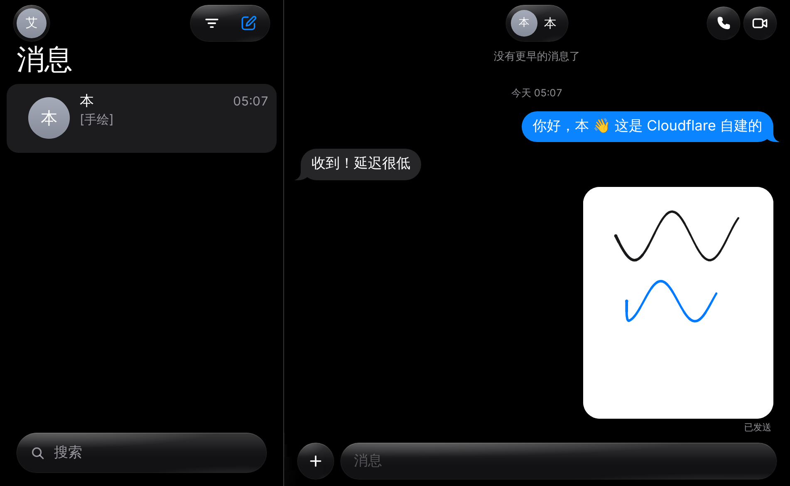
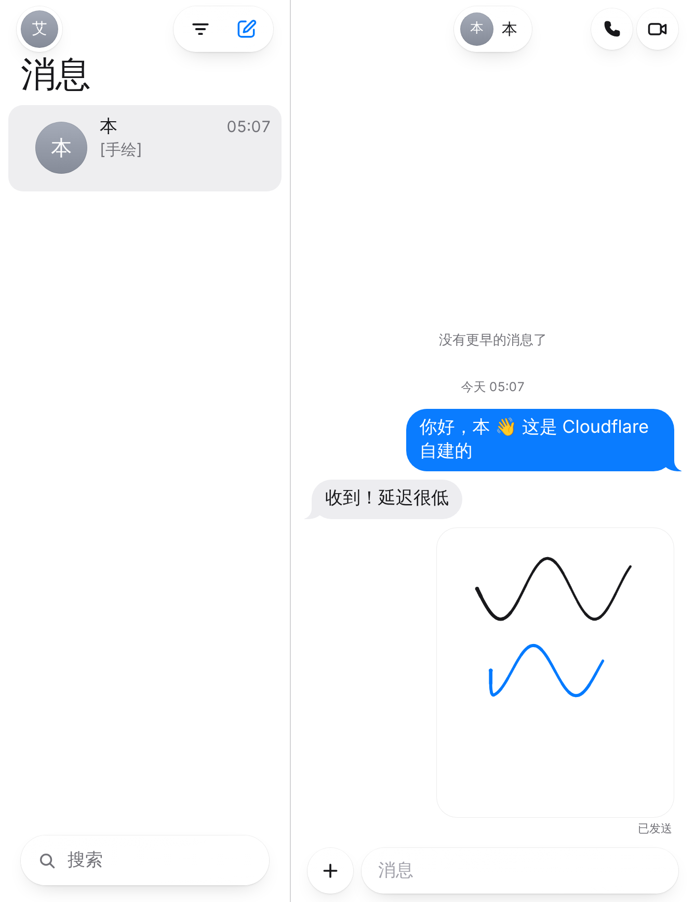
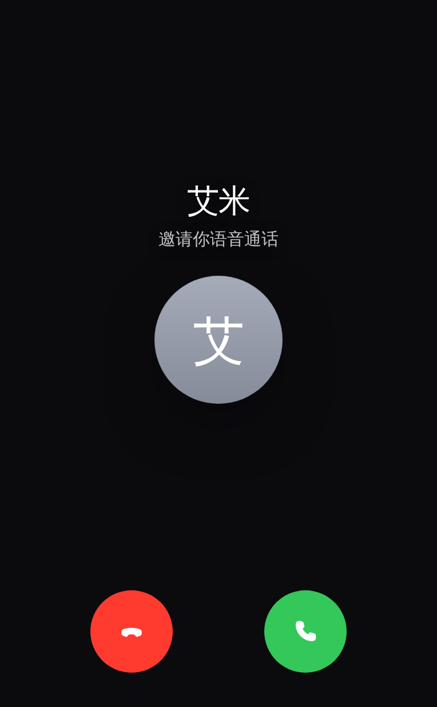

# Duo · Cloudflare 自建即时通讯

一个完全跑在 **Cloudflare** 上的自建即时通讯 App：注册账号、加好友、单聊和群聊、
发图片和手绘、语音 / 视频通话。没有第三方服务，消息和媒体都存在你自己的
Cloudflare 账号里。界面参考 iOS“信息”，并借鉴 Benji Taylor（Family / Honk /
drawesome）的设计与动效，专门为 **iPhone Duo** 的外屏（折叠）与内屏（展开）打磨。

| 外屏（382×618） | 内屏（横 951×585 / 竖 669×867） |
| --- | --- |
|  |  |
|  |  |
|  |  |
|  |  |

> 截图来自本地 `wrangler dev`，账号和消息都是演示数据；尺寸取自 WebKit 公布的 Safari 27.1 在 iPhone Duo 上的视口。

## 功能

- **账号**：用户名 + 密码注册 / 登录（PBKDF2 哈希），可选邀请码 `SIGNUP_CODE`
- **实时聊天**：单聊、群聊；消息经 WebSocket 实时送达，掉线自动重连补收
- **在线状态**与**已读回执**；**“正在输入”实时预览**（Honk 式：对方能看到你正在打的字）
- **图片**（手机端先压缩再传）与**手绘画板**（速度自适应笔触、调色板、撤销，发出为“手绘”消息）
- **语音 / 视频通话**：基于 **Cloudflare Realtime（SFU）**，一对一与群组都支持，自带 TURN 穿透
- **联系人**：按用户名查找、互相添加；发起单聊 / 新建群聊、群成员管理
- **通知**：新消息 Web Push（需加到主屏幕并配置 VAPID）
- **外观**：默认白色浅色界面，可切换深色 / 跟随系统；降低透明度、减少动态效果、触感反馈
- **iPhone Duo**：外屏与系统分屏为单栏推入 / 返回；内屏横竖都是列表 + 对话双栏（按两栏各自所需宽度决定，
  不按机型判断）。折叠、展开、进入分屏时保留当前对话、草稿、输入焦点和正在看的那条消息的位置；
  外屏横放等低高度下，画板工具移到画布旁、通话界面自动收紧；拨视频时先全屏预览自己的画面，接通后缩成角落小窗

## 架构

```
iPhone (PWA)  ──HTTPS / WebSocket──▶  Worker（瘦代理）  ──▶  Hub Durable Object "main"
  静态页面 public/                     /api /auth /rtc        · 账号 / 联系人 / 房间 / 消息（SQLite）
  Service Worker：离线壳 + 推送          转发到 Hub            · 可休眠 WebSocket 实时收发 + 在线状态
                                                             · 媒体校验后读写 R2
                        WebRTC 媒体 ◀──▶ Cloudflare Realtime  · 通话信令中转 + /rtc 代理（App Secret 只在服务端）
                        离线成员 ◀────── Web Push（VAPID）
```

- **Worker（`src/index.js`）**：只做转发与同源校验，所有状态都在一个 Durable Object 里。
- **Hub（`src/hub.js`）**：账号、联系人、房间、消息、在线状态、WebSocket 广播、通话信令，
  全部集中在一个 DO，SQLite 强一致，推理简单。
- **数据层（`src/store.js`）**：users / contacts / rooms / room_members / messages / push_subs。
- **媒体（`src/media.js`）**：上传按会话成员与大小校验后流式写入 **R2**；下载带 sandbox CSP + nosniff，
  按会话成员鉴权。
- **通话（`src/call.js`）**：信令走 WebSocket；媒体经 `/rtc/*` 代理到 **Cloudflare Realtime SFU**，
  App Secret 不下发浏览器；TURN 凭证由 Realtime TURN key 下发。
- **账号加密（`src/auth.js`）**：PBKDF2-HMAC-SHA256（310k 轮）哈希密码；HMAC 签名会话令牌，
  携带 epoch，可“全端退出”。

## 部署

需要一个 Cloudflare 账号。Durable Objects 的 SQLite 存储需要 Workers 付费版（$5/月）。

```bash
npm install

# 1) 创建 R2 存储桶（媒体文件）
npx wrangler r2 bucket create cf-messenger-media

# 2) 可选：设置邀请码，避免任何人都能注册
npx wrangler secret put SIGNUP_CODE

# 3) 部署
npx wrangler deploy
```

打开部署后的地址，点“创建账号”注册第一个用户即可。把地址发给朋友，各自注册、互相添加。

### 开启语音 / 视频通话（Cloudflare Realtime）

1. 在 Cloudflare 仪表盘创建一个 **Realtime（Calls）** 应用，拿到 App ID 和 App Secret。
2. 设置密钥并重新部署：

   ```bash
   npx wrangler secret put REALTIME_APP_ID
   npx wrangler secret put REALTIME_APP_SECRET
   # 可选：更好的 NAT 穿透（Realtime 的 TURN key）
   npx wrangler secret put REALTIME_TURN_KEY_ID
   npx wrangler secret put REALTIME_TURN_KEY_TOKEN
   ```

未配置时，通话入口会提示“通话服务未配置”，其余功能照常。

### 开启新消息通知（可选）

```bash
npm run vapid                          # 生成一对 VAPID 密钥
npx wrangler secret put VAPID_PUBLIC_KEY
npx wrangler secret put VAPID_PRIVATE_KEY
npx wrangler secret put VAPID_SUBJECT   # 例如 mailto:you@example.com
```

iOS 需先用 Safari“添加到主屏幕”，再从主屏幕打开，在“设置 › 通知”里开启。

### 配置项

| 名称 | 类型 | 说明 |
| --- | --- | --- |
| `SIGNUP_CODE` | secret，可选 | 注册邀请码；不设置则任何人都能注册 |
| `REALTIME_APP_ID` / `REALTIME_APP_SECRET` | secret | 语音 / 视频通话（Cloudflare Realtime SFU） |
| `REALTIME_TURN_KEY_ID` / `REALTIME_TURN_KEY_TOKEN` | secret，可选 | Realtime TURN，改善 NAT 穿透 |
| `VAPID_PUBLIC_KEY` / `VAPID_PRIVATE_KEY` / `VAPID_SUBJECT` | secret，可选 | Web Push 通知 |
| `DO_LOCATION_HINT` | var，默认 `apac` | Durable Object 首次创建的大致位置 |

## 本地开发

```bash
npm run dev          # wrangler dev，打开 http://127.0.0.1:8787 ，点“创建账号”
npm test             # 数据层与账号加密单测 + Web Push（RFC 8291 测试向量）
```

- 本地 `wrangler dev` 自带内存版 Durable Object SQLite 和 R2，无需额外配置即可跑通聊天与媒体。
- 想本地试通话 UI：`npx wrangler dev --var REALTIME_APP_ID:dummy --var REALTIME_APP_SECRET:dummy`
  （信令与来电界面可用；真正接通需要真实的 Realtime 应用）。
- 界面走查脚本：`node tools/e2e/walkthrough.cjs docs/screenshots` 用 Playwright（Chromium）
  注册两个账号，跑一遍登录 → 找人 → 实时收发 → 手绘 → 通话界面 → 展开 / 深色，并截图。

## 安全

- 密码用 PBKDF2-HMAC-SHA256（310k 轮）加随机盐哈希；会话是 HMAC 签名令牌（HttpOnly、SameSite=Strict）。
- 改密码会提升 epoch，使旧令牌失效（相当于全端退出）。
- 改状态的请求与 WebSocket 升级都做同源校验。
- 媒体下载响应带 `sandbox` CSP 与 `nosniff`，并按会话成员鉴权；上传限制大小与成员。
- 通话的 Realtime App Secret 只在服务端，浏览器只通过 `/rtc/*` 代理访问。

## 已知限制

- 语音 / 视频通话需要配置 Cloudflare Realtime 应用；未配置时入口会提示。
- 暂不支持录制语音消息（可发文字、图片、手绘；可打语音 / 视频通话）。
- 单个 Durable Object 承载全部状态，适合个人与中小群体自建；超大规模需要分片。
- 非端到端加密：消息在服务端（你自己的 Cloudflare 账号）以明文存储。
- 界面在 Chromium 中按 Safari 27.1 的 iPhone Duo 视口（外屏 382×580 / 594×368、内屏 669×867 / 951×585、
  分屏 385×571）、大字号与深色模式走查过；无法在真机上验证的部分：iOS 键盘动画、`<input switch>` 触感、
  `viewport-segments`（Safari 中仍需实验开关）、Apple 推送送达、真实 Realtime SFU 接通质量
  （开发环境无法访问 Realtime 服务）。

## 目录

```
src/            index.js（瘦代理）· hub.js（Durable Object）· store.js（SQLite）
                auth.js（账号加密）· media.js（R2）· call.js（Realtime 信令/代理）· push/
public/         index.html · manifest · sw.js · css/ · icons/
  js/           main.js · api.js · store.js
    ui/         视口与折叠、弹簧、手势、按压、外观、格式、触感
    views/      auth · chatList · thread · bubbles · composer · overlay · sheets · shell
                viewer · call（通话）· draw（画板）· avatar
tools/          gen-vapid.mjs · gen-springs.mjs · e2e/walkthrough.cjs
test/           store · auth · webpush
```

## 致谢

- 交互与视觉参考 iOS“信息”，并借鉴 **Benji Taylor** 的 Family（弹性物理与触感）、
  Honk（实时打字、无发送键）与 drawesome（手绘）。
- 语音 / 视频通话基于 [Cloudflare Realtime](https://developers.cloudflare.com/realtime/)（SFU）。
- Web Push 按 RFC 8291 / 8292 用 WebCrypto 实现。
