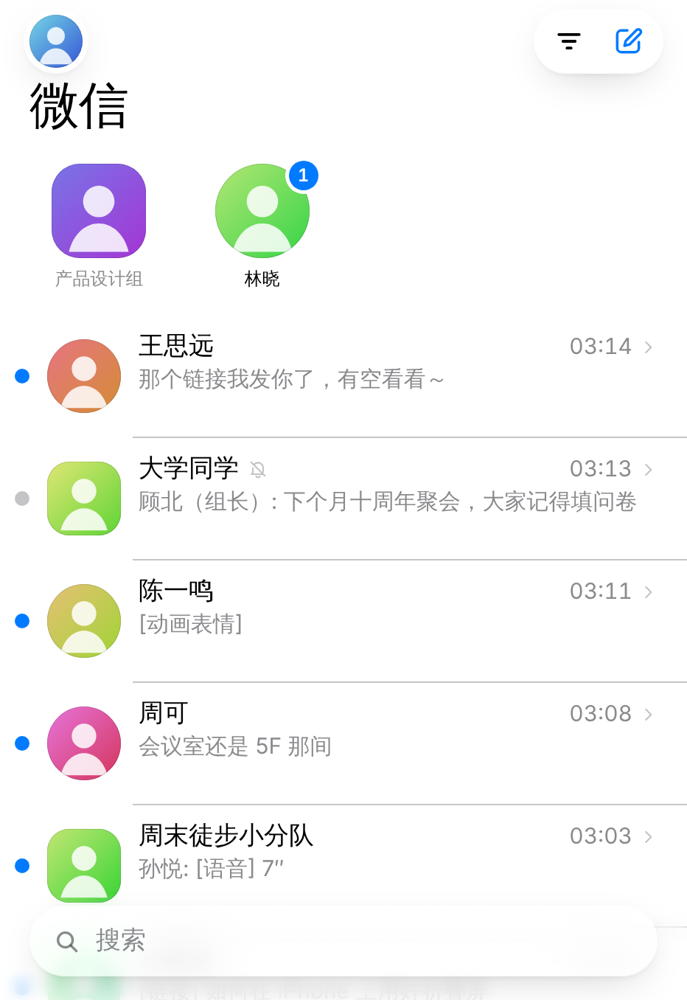
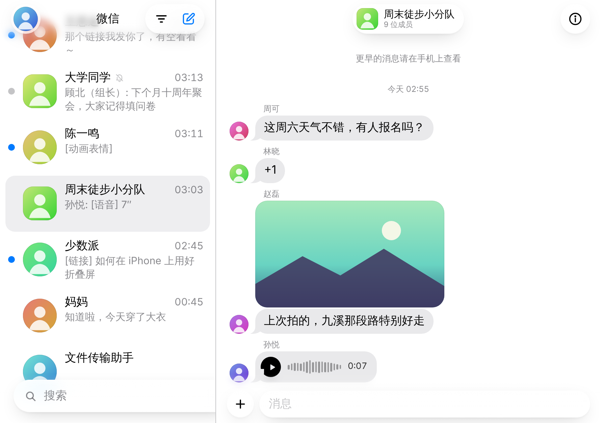
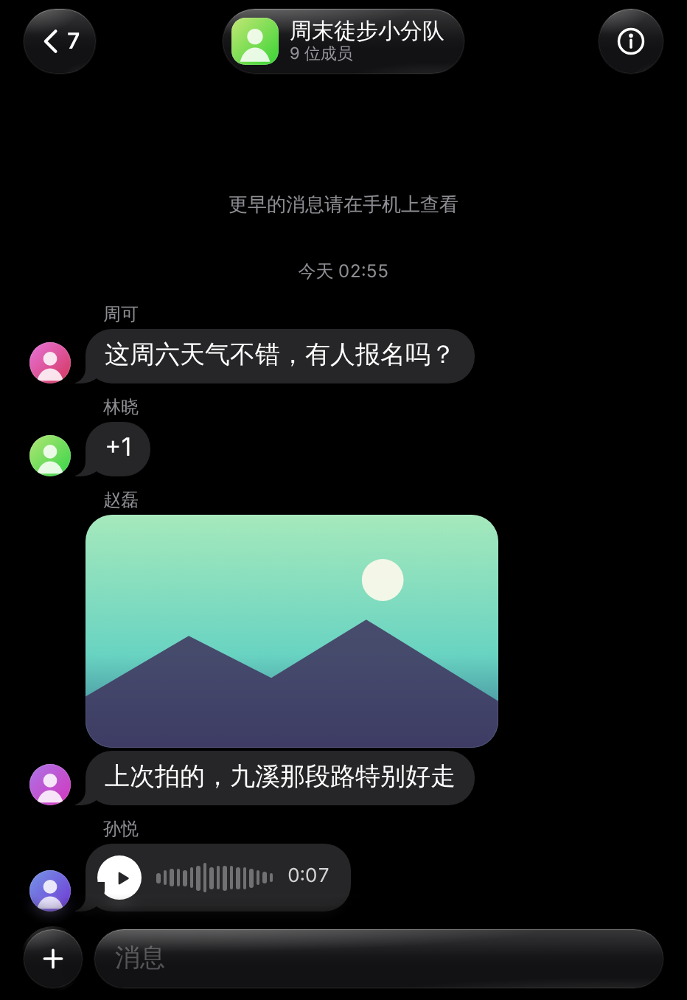
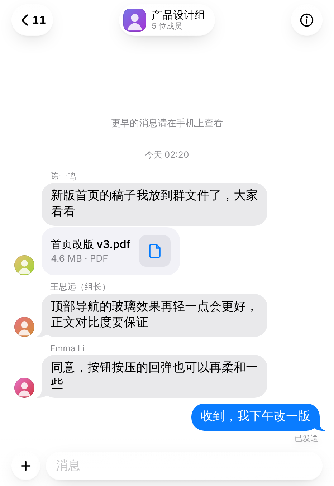
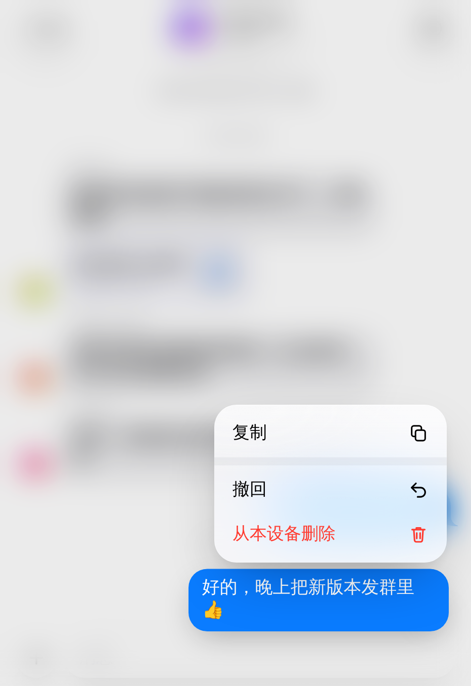

# 微信 · 个人网页客户端（Cloudflare Workers）

在 Cloudflare Worker 上运行的个人微信客户端：登录你自己的微信，查看并回复好友和群聊消息。界面参考 iOS“信息”，使用 Liquid Glass（液态玻璃）风格，专门为 **iPhone Duo** 的外屏（折叠）和内屏（展开）设计。

| 折叠（外屏 466×678） | 展开（内屏 890×626） | 深色 |
| --- | --- | --- |
|  |  |  |
|  |  |  |

> 截图来自本地模拟服务器（`npm run dev:mock`），联系人和消息都是演示数据。

## 先读这一段：协议风险

- 这是**非官方**客户端，基于微信网页版协议（UOS 桌面模式），协议实现参考 [wechat4u](https://github.com/nodeWechat/wechat4u)（MIT）。wechat4u 最后一次更新是 2023 年 12 月，**这条协议在今天是否仍可用，我没能验证**：开发环境无法访问微信服务器，所以登录、同步、发送都只在模拟服务器上跑通过。
- 微信可能拒绝网页登录（常见提示：“为了你的帐号安全，此微信号不能登录网页微信”，错误码 1203），也可能随时调整接口。遇到问题时，到“设置 › 连接 › 诊断信息”查看具体失败在哪一步、返回了什么错误码。
- 非官方客户端存在账号被限制的风险。请只用于自己的账号，不要用于群发、营销或自动化。
- 网页协议**拿不到登录之前的聊天记录**：列表会显示最近会话，但消息从你登录这一刻开始收集。

## 功能

- 扫码登录（二维码、已扫码待确认、过期刷新、登录失败原因），登录状态保存在服务器端，关闭页面不掉线
- 私聊、群聊收发文字；发送照片（手机上先压缩为 JPEG）；撤回 2 分钟内自己发出的消息
- 接收文字、表情符号、图片、动画表情、语音（可播放）、视频、链接卡片、文件（可下载）、位置、名片、引用回复、转账/红包提示、撤回提示和系统消息
- 群聊显示群昵称和成员头像；群信息页显示成员
- 置顶（同步到手机）、标为已读/未读、从列表删除会话、清空本设备记录
- 未读数与手机同步：在手机上看过的会话，这里的未读也会清除
- 搜索会话和联系人，支持拼音和首字母（如 `zk` → 周可）
- 发起新聊天（通讯录按拼音分组）
- 新消息通知（Web Push，需添加到主屏幕并配置 VAPID 密钥）
- 浅色/深色/跟随系统；降低透明度；减少动态效果；触感反馈

## 架构

```
iPhone (PWA)  ──HTTPS / WebSocket──▶  Worker  ──▶  Durable Object "main"  ──▶  微信网页版服务器
  静态页面 public/                    密码校验         · 扫码登录轮询（alarm）
  Service Worker：离线壳 + 推送        转发 /api/*      · synccheck / webwxsync 循环（alarm）
                                                       · SQLite：联系人、会话、消息
                                                       · 媒体代理（带会话 Cookie）
                                                       · WebSocket 实时推送 + Web Push
```

- **为什么用 Durable Object**：消息只会通过 `webwxsync` 下发一次，必须有一个常驻的地方持续接收并保存。Durable Object 用 alarm 驱动长轮询，手机锁屏、页面关闭都不会漏消息。重新部署或对象重启后，会用保存的 Cookie 继续会话，无需重新扫码。
- **从 wechat4u 移植到 Workers 时的改动**（`src/wx/`）：不用 `eval` 解析 `window.QRLogin…` 等响应（Workers 禁止 eval，逐个用正则解析）；自己维护 Cookie（Workers 的 fetch 没有 Cookie 罐）；登录跳转用 `redirect: 'manual'` 读取 301 响应体里的票据；保留 UOS 登录需要的 `extspam`/`client-version` 请求头；按每次 alarm 的子请求预算（默认 40，见 `ALARM_SUBREQUESTS`）分段运行，适配免费版每次调用 50 个子请求的限制。
- **重新登录后保留记录**：微信每次登录都会给联系人分配新的 UserName。同一账号重新登录后，会按“备注 + 昵称”把旧会话迁移到新联系人上；无法唯一匹配的旧会话保留为只读。
- **安全**：整个应用由 `APP_PASSWORD` 保护（HttpOnly + SameSite=Strict 签名 Cookie，失败 6 次锁定 10 分钟）；所有写操作和 WebSocket 都校验 Origin；消息内容只以文本节点渲染，链接只允许 http(s)；媒体代理的响应带 `sandbox` CSP，静态页面有严格的 CSP。

## 为 iPhone Duo 做的设计

| 形态 | 视口（CSS 像素） | 布局 |
| --- | --- | --- |
| 折叠，外屏竖握 | ≈ 466 × 678 @3x | 单栏：会话列表 → 推入对话 |
| 折叠，外屏横握 | ≈ 678 × 466 | 单栏，紧凑导航 |
| 展开，内屏 | ≈ 890 × 626 @3x | 双栏：左侧列表（约 320pt）+ 右侧对话 |
| 内屏 50/50 分屏 | ≈ 445 × 626 | 单栏 |

（视口数值来自第三方设备数据库的估算，代码不依赖具体数值，只在 700px 宽度处切换布局。）

- **折叠/展开不丢位置**：展开时正在看的对话直接出现在右栏，列表出现在左侧；折回时对话保持在最前面，返回键回到列表。切换瞬间关闭过渡动画，避免界面“甩”一下。
- **外屏又短又宽**：对话页顶部是悬浮的玻璃按钮而不是整条导航栏，底部输入栏贴合键盘，最大化正文高度；搜索框放在底部，单手可达。
- **展开时的面板**：设置、群信息等在外屏是从底部升起、可下拉关闭的浮动面板；在内屏变成居中的表单面板，就地“凝结”出现。
- **铰链**：如果浏览器把屏幕报告为两个视口分段（`horizontal-viewport-segments: 2`），分栏会对齐到折痕。
- **Liquid Glass 只用在功能层**：顶部按钮、输入栏、搜索框、菜单、面板。玻璃由透色、背景模糊与饱和、竖向光泽、内反光、高光边缘、内侧暗边、悬浮阴影叠成，按下时会朝手指微微鼓起并在触点泛光。正文区域保持纯色，内容滚到悬浮控件下方时，用模糊渐隐代替分割线。
- **动效**：iOS 式弹簧（阻尼比 + 响应时间），由 `tools/gen-springs.mjs` 采样为 CSS `linear()`，感知时长约 200–300ms。返回手势 1:1 跟手，松手时按速度预测落点并把速度交给弹簧；面板下拉关闭、图片查看器的缩放和下滑关闭同理，动画随时可被手指打断。新消息轻弹出现，自己发送的消息从输入栏升起。
- **可访问性和降级**：
  - 跟随“减弱动态效果”（改为淡入淡出）、“降低透明度”和“增强对比度”；
  - 浏览器不支持 `backdrop-filter` 时，自动换成实色界面；
  - 滚动时持续掉帧，也会自动换成实色界面，可在设置里改回；
  - 字号跟随 iOS“动态字体”；所有图标按钮都有无障碍标签；点击区域不小于 44pt。

## 部署

需要：Cloudflare 账号、Node.js 20+。

```bash
npm install
npx wrangler login
npx wrangler secret put APP_PASSWORD      # 本应用的访问密码
npm run deploy
```

部署完成后，在 iPhone 的 Safari 打开 Worker 地址，点“分享 › 添加到主屏幕”，再从主屏幕打开（独立窗口、通知和返回手势都需要这一步）。输入访问密码后进入扫码页：

- 二维码在这台 iPhone 上，没法用同一台手机扫。可以在电脑或平板上打开同一地址扫码，会话在服务器端，扫完后 iPhone 上直接可用；
- 也可以点“保存二维码”，在微信“扫一扫 › 相册”里选它，但部分微信版本可能不支持。

### 新消息通知（可选）

```bash
npm run vapid                              # 生成密钥对
npx wrangler secret put VAPID_PUBLIC_KEY
npx wrangler secret put VAPID_PRIVATE_KEY
npx wrangler secret put VAPID_SUBJECT     # 例如 mailto:you@example.com
```

然后在 App 内“设置 › 通知”打开。只有在没有窗口处于前台时才会推送，免打扰的会话和公众号不推送。

### 配置项

| 名称 | 类型 | 说明 |
| --- | --- | --- |
| `APP_PASSWORD` | secret，必填 | 访问密码；修改后所有设备需重新输入 |
| `VAPID_PUBLIC_KEY` / `VAPID_PRIVATE_KEY` / `VAPID_SUBJECT` | secret，可选 | Web Push |
| `DO_LOCATION_HINT` | var，默认 `apac` | Durable Object 首次创建的位置，离微信服务器近一些 |
| `ALARM_SUBREQUESTS` | var，默认 40 | 每次 alarm 的子请求预算；付费版可调大 |

### 费用

登录后 Durable Object 会一直在线做长轮询。按 128MB 内存全天在线估算，约 10,800 GB-s/天。Workers 免费版包含 SQLite 版 Durable Objects，但有每日用量上限，这个用量接近上限；Workers 付费版（$5/月）的包含额度足够一个账号使用。以 [Cloudflare 定价页](https://developers.cloudflare.com/durable-objects/platform/pricing/) 为准。

## 本地开发

```bash
npm run dev:mock     # 模拟微信服务器 + wrangler dev，打开 http://127.0.0.1:8787 ，密码 demo
npm test             # 协议解析、消息规范化、存储、Web Push 加密（RFC 8291 测试向量）
```

- 模拟服务器（`tools/mock-wx.mjs`）实现了登录、通讯录、同步、发送、上传、撤回和媒体接口。扫码用 `curl -X POST 127.0.0.1:8790/__ctl/scan`，确认登录用 `.../__ctl/confirm`，`MOCK_AUTO=1` 时自动完成。模拟来消息用 `.../__ctl/incoming -d '{"from":3,"text":"你好"}'`。
- 界面走查脚本 `tools/e2e/*.cjs` 用 Playwright（Chromium）按 iPhone Duo 尺寸截图。
- 想连真实微信：复制 `.dev.vars.example` 为 `.dev.vars`，然后 `npm run dev`。

## 目录

```
src/
  index.js          Worker 入口：密码校验、静态资源、转发 /api
  auth.js           访问密码与签名 Cookie
  session.js        Durable Object：登录、同步循环、API、媒体代理、WebSocket、推送
  store.js          SQLite 存储（会话、消息、联系人、重新登录迁移）
  wx/               微信网页协议（client / parse / normalize / conf）
  push/webpush.js   VAPID + aes128gcm
public/             前端（无构建步骤的原生 ES 模块）
  css/              tokens / base / glass / list / thread / overlays / auth
  js/ui/            视口与折叠、弹簧、手势导航、按压反馈、外观
  js/views/         列表、对话、气泡、输入栏、查看器、面板、登录
tools/              模拟服务器、本地开发、弹簧采样、VAPID、界面走查
test/               node:test 单元测试
```

## 已知限制

- 看不到登录前的历史消息（网页协议限制），也不能修改“消息免打扰”。
- 不能发送语音、视频、文件和表情包，只能发文字和图片；语音/视频通话、红包、转账只显示提示。
- 没有对方已读回执，“已发送”表示服务器已接收。
- 无法在真机上验证的部分：iOS 键盘弹出时的具体动画、`<input switch>` 触感反馈（需要 iOS 18 及以上）、iPhone Duo 上 `viewport-segments` 的实际支持情况。
- 同一时间只支持一个微信账号。

## 致谢

- [wechat4u](https://github.com/nodeWechat/wechat4u)（MIT）：网页协议流程、请求格式和 UOS 登录参数
- [qrcode-generator](https://github.com/kazuhikoarase/qrcode-generator)（MIT）：二维码 SVG
