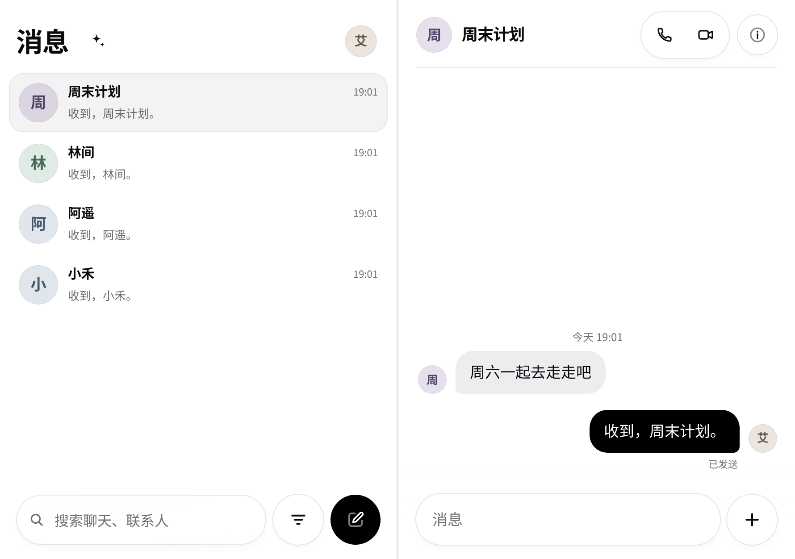
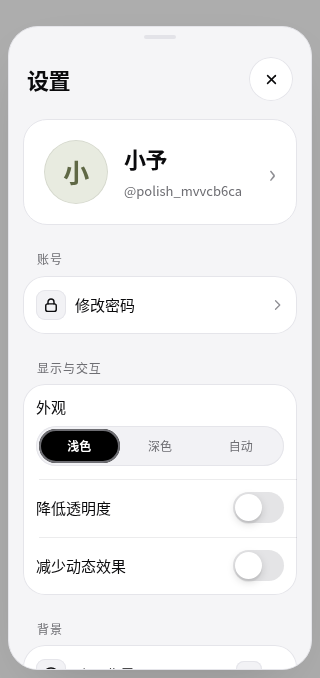
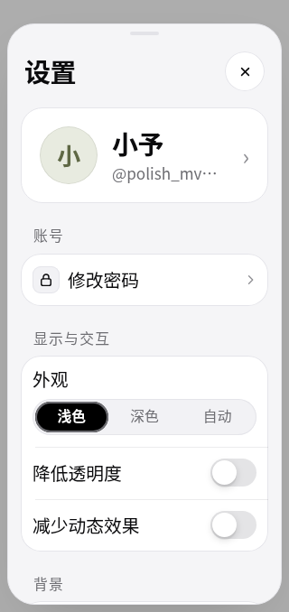
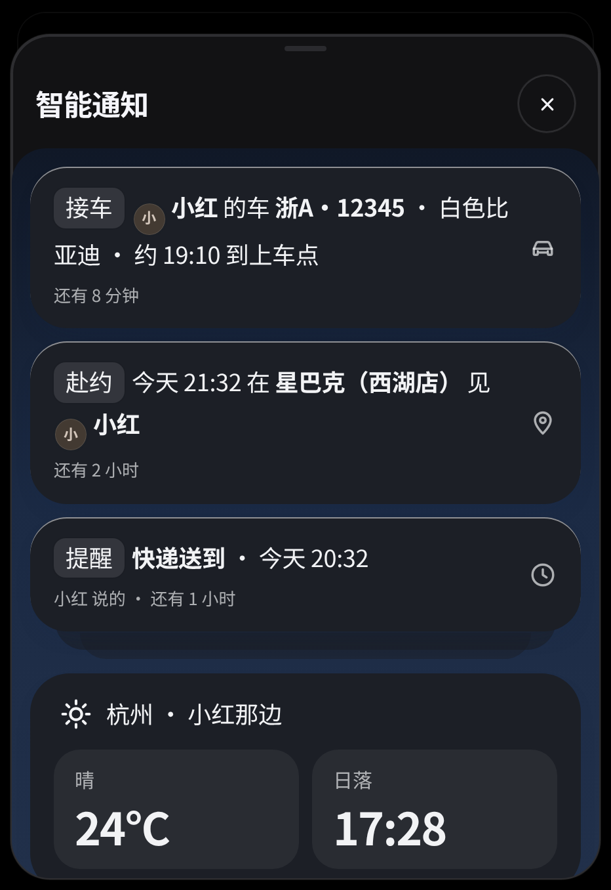
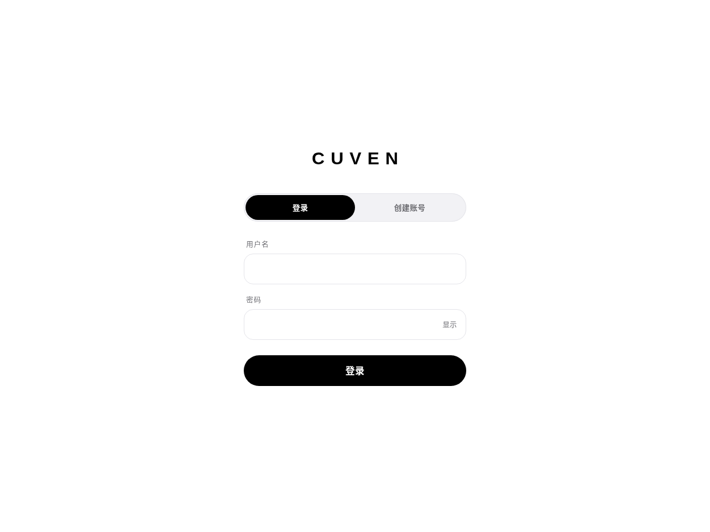

# UI / UX 细节统一

沿用 Cuven 的纸白、近黑和底部胶囊栏，统一日常使用中反复出现的细节：

- 人物头像保持圆形，群聊保持圆角矩形；列表、置顶、联系人和对话使用同一规则。深色模式使用更柔和的头像底色。
- 登录和弹层表单共享 52px 高度、16px 内边距和圆角，以及相同的文字与错误提示规格。
- 输入提示有独立的可读颜色；装饰图标保留原有层级。
- 列表入口、侧栏和资料卡采用一致的悬停／按压反馈，滚动或取消手势时撤销按压。
- 窄屏、大字号下，设置中的外观选项独占一行；背景名称可截断，行末图标不会撑出卡片。
- 外观选项支持方向键、Home / End，整组只有一个 Tab 停留点；弹层焦点循环尊重这一规则。表单标签可点击聚焦字段。
- 智能通知和天气卡片遵循降低透明度／增加对比度偏好；关闭与收起按钮至少 44px。

## 本地浏览器截图



  



## 验证

`npm test`：74 项通过。

启动 `npm run dev:e2e` 后，在本地 Chromium 运行：

```sh
node tools/e2e/ui-polish.cjs /tmp/cuven-ui-polish
node tools/e2e/design-details.cjs /tmp/cuven-design-details
node tools/e2e/continuity.cjs /tmp/cuven-continuity
node tools/e2e/strip.cjs /tmp/cuven-strip
node tools/e2e/insights.cjs /tmp/cuven-insights
```

覆盖键盘焦点与标签、320px／大字号、发送和失败重试、图片预览、折叠连续性、安全区与双栏、智能通知明暗及不透明材料。智能通知的 AI 响应使用测试数据，账号、会话和消息通过本地服务创建。未验证 iPhone 实机。
